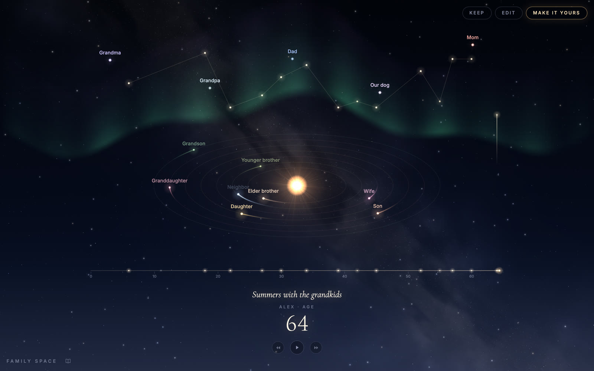
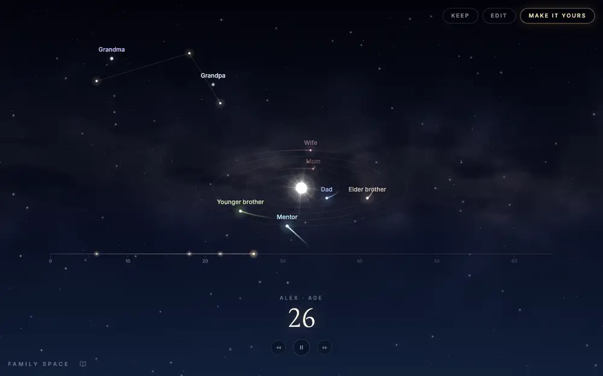
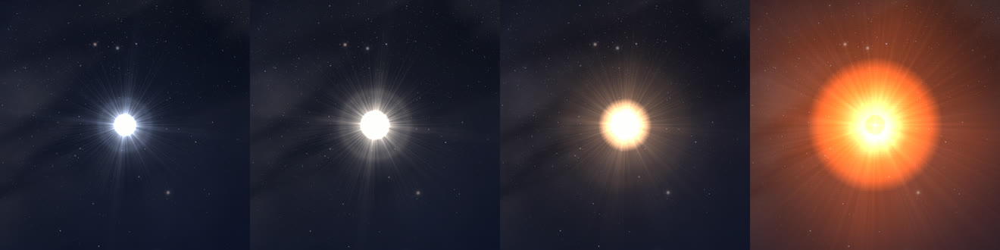
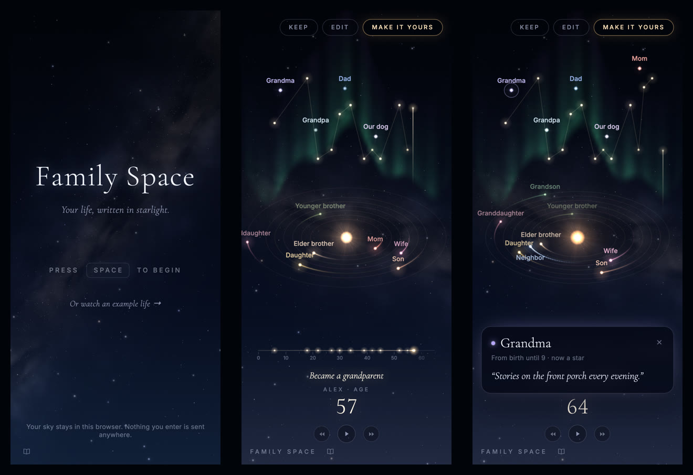

<div align="center">


# Family Space

**Your life, written in starlight.**

A life drawn as a solar system: the people who stayed, the ones who passed through like comets, and the ones who became stars.

[](https://familyspace.raisingthegiftedmind.com)
[](https://familyspace.raisingthegiftedmind.com/example)
[](LICENSE)


[**Try it**](https://familyspace.raisingthegiftedmind.com) · [**Example life**](https://familyspace.raisingthegiftedmind.com/example) · [How it works](#what-happens-in-the-sky) · [Run it locally](#getting-started)

<br />

<a href="https://familyspace.raisingthegiftedmind.com/example">
  
</a>

</div>

<br />

Family Space turns a life into a sky you can watch unfold. Your star sits at the centre and ages with you, from a blue-white childhood to a red giant in old age. The people who stay orbit it, the people who pass through cross it as comets, and the people who die rise into the sky and become stars. The moments that changed your life, a first child or a move across the country, light up a constellation of their own above.

You add your people and your moments in a few short questions, then press play and travel through the years.

## See it move

<div align="center">
  
  <sub>Age 26 to 30 in the example life: a wedding fills the sky with an aurora, then a first child arrives.</sub>
</div>

## What happens in the sky

| In your life | In the sky |
| --- | --- |
| **People who stay** | Settle into orbits around your star. When someone leaves, the others close ranks. |
| **People who pass through** | Arrive as comets: a straight run in, a swing around your star, and a straight run out. |
| **People who die** | Rise into the upper sky, burst as a nova and become a star there, keeping a faint glow that slowly breathes. Your own star dims and wavers for a while in grief. |
| **Milestones** | Make your star flare. |
| **A new home** | Turns the whole sky around you. |
| **Love** | Fills the sky with an aurora. |
| **Hard times** | Darken the sky and draw everyone a little closer. |

Every moment's light rises from its bead on the lifeline to its own star in the sky, so your moments gather into a constellation as the years pass. Tap any star to read about it or to write a line of memory.

## Your star ages with you

<div align="center">
  

| Age 6 | Age 32 | Age 58 | Age 96 |
| :---: | :---: | :---: | :---: |
| Hot and blue-white | In its prime | Cooling to gold | A red supergiant |

</div>

Your star follows a stellar life. Its colour comes from a blackbody temperature curve, cooling from about 11,000 K in childhood to about 3,100 K at 100. After 40 it swells into a red giant with a mottled surface, and past 80 into a slowly pulsing red supergiant, something like Betelgeuse.

## Made for phones too

<div align="center">
  
</div>

On every screen, the lifeline along the bottom is the one place to travel through the years, so a stray swipe across the sky never sends them spinning.

## Private by design

There are no accounts, no backend and no tracking in the code. Everything you enter stays in your browser's local storage and is never sent anywhere. Videos and images you export are made on your own device.

## Controls

| Action | Keyboard and mouse | Touch |
| --- | --- | --- |
| Play or pause | <kbd>Space</kbd> or the play button | Tap the sky |
| Step a year | <kbd>←</kbd> <kbd>→</kbd> | |
| Travel through the years | Drag along the lifeline | Drag along the lifeline |
| Jump between moments | Click <kbd>⏪</kbd> or <kbd>⏩</kbd> | Tap <kbd>⏪</kbd> or <kbd>⏩</kbd> |
| Rewind or fast-forward at 2× | Hold <kbd>⏪</kbd> or <kbd>⏩</kbd> | Hold <kbd>⏪</kbd> or <kbd>⏩</kbd> |
| Remember someone | Click their star | Tap their star |

**Keep** records the journey as a video, ending on a card with the site's address, or saves the moment as an image. **Make it yours** turns the example life into a starting point for your own.

## Getting started

You need [Node 22](https://nodejs.org) and [pnpm 10](https://pnpm.io).

```sh
git clone https://github.com/wasi0013/family-space.git
cd family-space
pnpm install
pnpm dev          # http://localhost:5173
```

```sh
pnpm test         # run the test suite
pnpm build        # type-check and build the static site into dist/
pnpm preview      # serve the built site
```

### Development shortcuts

A few URLs open the app in a particular state. None of them read or overwrite a saved sky.

| URL | Opens |
| --- | --- |
| `/example` | The example life, as visitors see it |
| `?demo` or `?demo=45` | A sample life at age 32, or at the age given |
| `?demo&cast=crowd` | A crowded early life, to test busy skies |
| `?age=14.5` | The journey paused at that age |
| `?people`, `?moments` | That step of the questions |

## How it's built

Family Space is a static React and TypeScript app built with Vite. It draws on two Canvas 2D layers, the night sky behind and the life scene in front, blended together. The scene is a pure function of age, so playing, scrubbing, rewinding and recording all draw the same frame for the same year.

```
src/
├── scene/     the solar system: orbits and comets, the star's life, phenomena, the lifeline
├── sky/       the night sky, painted once into layers; only twinkling stars redraw while it holds still
├── keep/      video recording and image export
├── screens/   the title screen and the questions
├── i18n/      every word the app shows
└── example.ts the example life
```

A few details worth a look:

- **[`stellar.ts`](src/scene/stellar.ts)** turns an age into a temperature, colour, size and stage, using Tanner Helland's blackbody fit.
- **[`orbits.ts`](src/scene/orbits.ts)** lays out lanes that close ranks over time, comet paths, and the rise of the departed into the sky.
- **[`momentSky.ts`](src/scene/momentSky.ts)** places each moment's star straight above its year, clear of the stars and names of the departed.
- **[`SkyRenderer.ts`](src/sky/SkyRenderer.ts)** paces itself to what moves, so a still sky costs very little.

## Deploying

The build is a folder of static files, so any static host works. The site runs on Cloudflare Pages with the build command `pnpm build`, the output directory `dist`, and `NODE_VERSION=22`. The build also writes `example.html`, so the example life has its own address and link preview.

## Contributing

Issues and pull requests are welcome. Please run `pnpm test` and `pnpm build` before opening a pull request.

## License

Released under the [MIT License](LICENSE).

<div align="center">
<br />
<sub>Made alongside <a href="https://raisingthegiftedmind.com"><em>Raising the Gifted Mind</em></a>.</sub>
</div>
